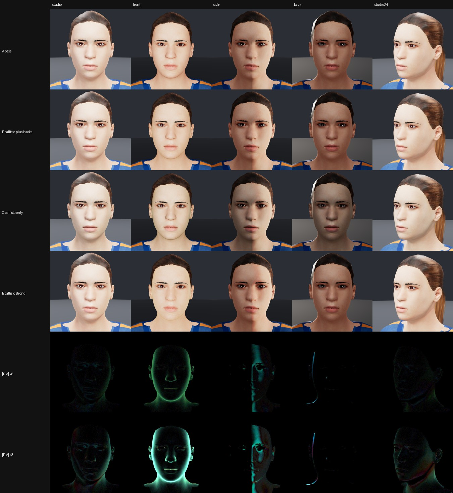
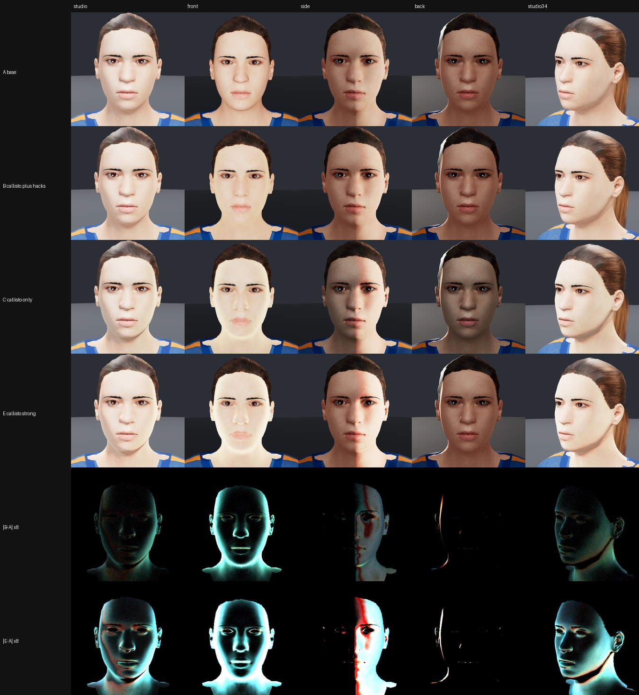
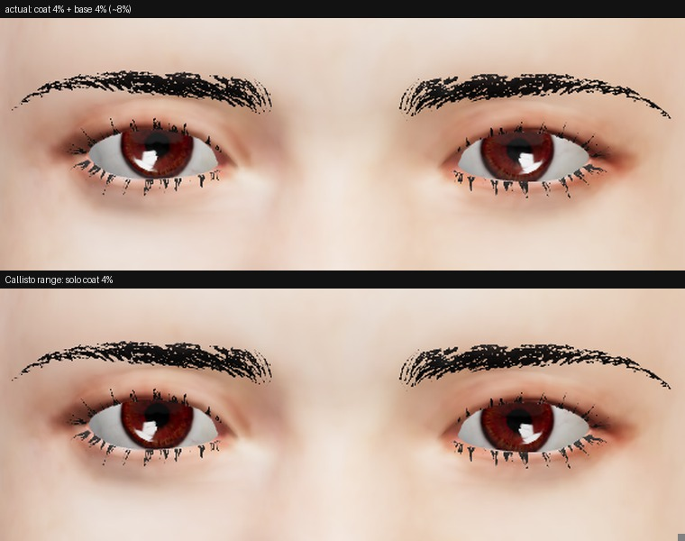

# Callisto Protocol (SIGGRAPH 2023) aplicado al humano three.js: lectura crítica y prueba A/B

Fecha: 2026-11-05 · Rama: `exp/three-human` · Fuente: Jimenez y Petersen, "The Rendering of The Callisto Protocol", SIGGRAPH 2023 Advances (335 diapositivas, leídas completas) · Recomendado por Alex.

## Veredicto

**No vale la pena incorporar los términos Callisto a la piel hoy.**
- Están bien implementados: con sus valores por defecto reproducen nuestro sombreado exacto.
- No cuestan nada medible.
- Pero en ningún ajuste hicieron que la cara se vea más real.

Lo único que se incorpora es **la reflectancia de los ojos**: un dato medido del deck, en una línea de código.

El motivo es de escala:
- Callisto corrige un **segundo orden** sobre cabezas escaneadas que ya tienen piel con subsuperficie, mapas de poros y fotos de referencia OLAT (una luz cada vez) contra las que ajustar.
- Nuestra distancia a la foto es de **primer orden**: textura MakeHuman de 2014, sin mapa de normales ni poros, sin subsuperficie real, pelo de tarjetas simples.
- Retocar la BRDF sobre esa base no se nota.

## Qué tiene el deck y qué sirve

| Parte | Qué es | ¿Sirve para three.js? |
|---|---|---|
| Callisto BRDF (diap. 66-98) | Lambert + GGX con controles explícitos: Fresnel difuso, retrorreflexión, terminador suave, caída del Fresnel especular, doble lóbulo | **Probado aquí.** Implementable y barato; sin efecto visible útil sin referencias para ajustar |
| Ojos (diap. 36-42) | La reflectancia real del ojo es 2,5-5,5 % (4 %+ con emoción) por interferencia de película fina, no el 2 % del libro | **Sí, incorporado.** Teníamos ~8 % (capa transparente 4 % + especular base 4 %) |
| Flujo OLAT y "explícito > implícito" (diap. 43-47) | Validar siempre contra fotos medidas, no contra la física | **Sí, como método.** Es lo que falta para que la BRDF Callisto sirva |
| Antialiasing especular [Chan18] y Proxima BRDF (diap. 117-131) | Coherencia del material con la distancia cuando hay mapas de normales | No por ahora: nuestras pieles no traen mapas de normales. Útil si se añaden poros |
| Realis (diap. 138-142) | Residuo foto-render horneado por dirección de luz | No: exige capturas en estudio de luces. Nuestra proyección de foto del Twin es la versión pobre de esa idea |
| Mitad de Petersen (raytracing en consola) | Sombras, reflejos y transmisión por raytracing, async compute | No aplica a WebGL |

Ojo con el deck:
- **No publica valores de piel.** Las tablas de parámetros son de materiales MERL: plásticos, pinturas, telas.
- Para piel solo hay imágenes antes/después.
- Rango de intensidades: 0 a 256. Por ejemplo, "Diffuse Fresnel 175" en plástico negro.

## Ecuaciones implementadas (diapositivas 85, 90 y 95)

```
Lo = (c1(θd,θh) · f_lambert + f_ggx) · c2(θi) · Li · cosθi

c1 = lerp(1, ρf, αf) · lerp(1, ρr, αr)                         Fresnel difuso × retrorreflexión
αf = h(θd, r(nf), θh, r(mf))     αr = h(θh, r(nr), θd, r(mr))
h(θ, n, φ, m) = (1 − cosθ)^(5n) · cosφ^(5m)       r(x) = 2(1 − x)

c2 = lerp(1, smoothstep(0, αs·p, cosθi), αs·o)                 terminador suave
αs = (1 − (1 − cosθd)³) · (1 − (1 − cosθh)³)

F  = f0 + sat(2 − r(ns)) · (1 − f0) · (1 − cosθ)^(5·r(ns))     caída del Fresnel especular (ns = 0,5 → Schlick)
```

Más el doble lóbulo especular: un segundo GGX con la rugosidad × escala, mezclado por opacidad. Código: [`frontend/src/human/skin.ts`](../../frontend/src/human/skin.ts), apagado por defecto (`model: 'base'`).

## Prueba

- **Sujetos:**
  - el Twin del retrato de prueba (textura con la luz de la foto horneada);
  - el humano del creador (piel MakeHuman, más cercana a un albedo puro).
- **Luces:** estudio, una sola luz frontal, lateral a 90°, contraluz, y estudio en 3/4.
- **Captura:** animación congelada y ojos abiertos.
- **Variantes:**

| Variante | Qué es |
|---|---|
| A | Actual: Lambert + GGX, más el levantado cálido y el brillo melocotón |
| D | Callisto con valores por defecto (control de implementación) |
| B | Callisto suave, encima de A |
| C | Callisto en lugar de los trucos de A |
| E | Callisto fuerte, encima de A |

Barrido de intensidades:
- **Suave:** ρf 2-4, ρr 2-4.
- **Fuerte:** ρf 10-60, ρr 6-25, terminador 1, caída especular 0,3 y doble lóbulo 0,3.

### Resultados

| Medida | Resultado |
|---|---|
| D frente a A (¿implementación correcta?) | Diferencia media en la cara 0,01-0,09 de 255: **idénticos** (solo se pierde la compensación multiscatter de three.js) |
| Coste GPU (120 cuadros, cara a pantalla completa) | 1,51-1,63 ms por cuadro en todas las variantes; las diferencias son ruido |
| Cambio visible, suave | 0,06-0,9 de 255 de media en la cara: **invisible** |
| Cambio visible, fuerte | 2-10 de 255 |
| Calidad, fuerte | **Peor**: con luz frontal la cara se lava y pierde volumen; con luz lateral aparece una costura rojiza en el terminador |
| Parecido (ArcFace del Twin contra la foto) | A 0,39 / 0,52 / 0,38 / 0,47 / 0,27 (estudio / frontal / lateral / contraluz / 3/4). Las variantes Callisto se mueven ±0,02-0,03: **ruido** |
| "¿Parece foto?" (CLIP: foto frente a render 3D) | Foto real 99,98 %. Todas las variantes, entre 0 % y 2,6 %, con media 0,2-0,7 %. Dos capturas idénticas de A difieren lo mismo: **sin efecto** |
| Quitar el levantado cálido (C) | **Empeora**: la piel queda gris. Nuestro truco barato de subsurface hace más que toda la BRDF |
| Ojos a 4 % | Desaparece el velo especular difuso del iris; queda el brillo nítido. Sutil y dentro del rango medido |





Filas inferiores de las hojas: |B−A| y |E−A| amplificados ×8. Muestran que cada término actúa donde debe: la retrorreflexión en la silueta con luz frontal, la banda en el terminador con luz lateral y casi nada con contraluz. Funciona; solo que no aporta realismo a esta base.

## Qué mejoraría la piel de verdad (por impacto)

1. **Subsurface real.** El propio Jimenez publicó el SSS separable (2015), que es la prueba lógica siguiente. La variante C demuestra que la luz que atraviesa la piel pesa más que la BRDF.
2. **Mapa de detalle de poros** en mosaico, con antialiasing [Chan18] para que no brille de lejos.
3. **Albedo de más resolución**, generado por IA en el espacio UV de MakeHuman (necesita presupuesto de imagen).
4. Después, si se capturan fotos de referencia con luces conocidas (aunque sea con un móvil y una lámpara), **ajustar los parámetros Callisto contra ellas**, que es el método que el deck propone.
