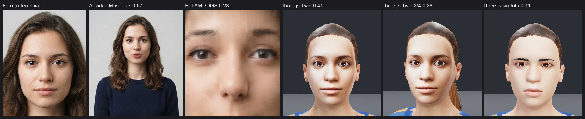

# Experimento exp/three-human: un "MetaHuman propio" en three.js frente a nuestro pipeline

Fecha: 2026-11-04 · Rama: `exp/three-human` · Decide: Marcelo

> **Decisión (2026-11-05, Marcelo):**
> - El vídeo (A) se mantiene para el Twin fotorrealista y los vídeos de redes.
> - El humano three.js pasa a ser el modo 3D, en lugar de seguir gastando GPU en la Etapa B.
>
> **Hecho desde entonces:**
> - Voz en streaming: primer audio de 3,6 s a 1,4-1,6 s.
> - Revisión de Callisto Protocol: [CALLISTO.md](CALLISTO.md).

## Estudio (2026-11-05): nueva UI de configuración

`?human=1` abre el estudio. El panel técnico anterior sigue en `?human=lab`.

**Dos mundos sobre el mismo escenario.**
- **Personaje:** cuerpo, cara, piel, pelo y ojos, o un Twin desde tu foto.
- **Ropa (Fitting):** conjuntos, zapatos, sombreros, accesorios y pelo.

**Cómo se elige.**
- **Arco de tarjetas de cristal.** Al asentarse, la prenda se prueba con la línea de escaneo.
- **Percha.** Vista alternativa inspirada en una tienda real; se cambia con el botón "Percha / Arco". Las prendas cuelgan de perfil en una barra cromada y la del centro gira hasta quedar de frente (fotogramas a 0°, 30°, 60° y 90°, con fundido cruzado). Lleva etiqueta amarilla, pared gris y título en bajorrelieve ("mujer / conjuntos").
- **Atuendo de partida:** camiseta blanca y vaqueros.
- **Clic directo sobre el cuerpo.** La ropa abre Conjuntos, el pelo abre Pelo y la cara abre los sliders de Cara.
- **Texto o voz.** Por ejemplo: "ponle aros dorados y cambia la ropa a blanco".

**Personajes.** 14 personas variadas: edades de 8 a 75, todas las complexiones y orígenes africano, asiático, latino, indio y europeo.
- Están hechos con el mismo cuerpo Anny y los recortes salen del propio creador (`?human=gen` → `human/studio/*.webp`).
- Coste de imagen: 0.

**Material Liquid Glass.**
- Sigue la receta de 6 capas de Kubai (Lumno): sombra, desenfoque con saturación y brillo, refracción de borde con dispersión, tinte, luz de borde y color de texto.
- La refracción usa un mapa de desplazamiento SVG en `backdrop-filter` (`studio/liquid.ts`), solo en Chromium.
- Safari y Firefox se quedan con el cristal esmerilado.

**Edición por lenguaje.** `POST /api/v1/human/edit` devuelve operaciones validadas contra el catálogo.
- **LLM:** nivel Sol (gpt-6.1-sol, con Claude Sonnet de respaldo), en ~2-2,8 s. Acertó 5 de 5 frases de prueba, donde gpt-4o-mini falló en 3.
- **Voz:** Whisper local.

**Niveles de modelo** (los mismos de animation-studio):
- **Chat hablado:** Luna (gpt-6-luna, `reasoning_effort: low`), primer token en 0,6-0,9 s. Respaldo: Claude Haiku.
- **Editor:** Sol. Respaldo: Claude Sonnet.
- **Astra:** queda para tareas pesadas.

**Nuevo en el motor:** aros, pendientes, gafas y gafas de sol en el hueso de la cabeza; teñido real de prendas (de luminancia a color, ya puede pasar a blanco); clic sobre el cuerpo por raycast; encuadre suave según la altura.

**Pendiente:**
- La ropa CC0 de MakeHuman es limitada: 12 conjuntos y casi todo vaqueros y camisetas.
- El peso alto de Anny apenas se nota en los personajes "corpulentos".
- Medir fps en móvil real.

## Resumen

Inspirado en el post de robot 2.0 (@alightinastorm, "Vibe Human 2.0", 2 nov 2026): creador de humanos 3D en three.js, con ropa, pelo, animación procedural y voz. Su repositorio público (`vibe-stack/vibe-human`) no tiene licencia y el origen de sus modelos es desconocido, así que **no se usó su código**. El experimento se construyó con piezas de licencia limpia:

- **Cuerpo:** Anny de NAVER (Apache-2.0). Modelo paramétrico diferenciable de bebé a anciano, 104 huesos y 52 expresiones ARKit.
- **Pieles, pelo, ropa, ojos, cejas, pestañas y dientes:** MakeHuman, CC0.
- **Render y animación:** three.js en el navegador, sin GPU de servidor.
- **Voz:** el mismo orquestador A0 del Feed (LLM + ElevenLabs con visemas).

**Veredicto:**
- three.js gana en todo lo interactivo y de coste: cuerpo entero, caminar, cambiar ropa y pelo al instante, coste de render cero, latencia y licencias.
- El vídeo (Etapa A) sigue ganando en fotorrealismo y parecido.
- Frente al 3D actual de la Etapa B (LAM), three.js **parece más la persona** (ArcFace 0,41 frente a 0,23), sin GPU y en 13 s de CPU.

**Recomendación:**
- Mantener A para el Twin fotorrealista y los vídeos de redes.
- Adoptar el humano three.js como el modo 3D (mundos, Seres inventados, Sofía de cuerpo entero), en lugar de seguir invirtiendo GPU en la Etapa B.

## Qué se construyó

| Pieza | Archivo | Qué hace |
|---|---|---|
| Horneado | `human/baker.py` | Anny + proxies MakeHuman → GLB con esqueleto, pesos y 52 morphs ARKit. Ropa y pelo se ajustan solos a cualquier cuerpo. |
| Servicio | `human/server.py` | `POST /bake` (0,2-0,45 s), `GET /catalog`, `GET /asset` y `POST /twin/fit`, en el puerto 8010. Python 3.14. |
| Twin | `human/twin.py`, `human/landmarks.py` | Ajusta la cara de Anny a los puntos de MediaPipe de la foto y proyecta la foto en la textura UV (visibilidad + igualado de tono). |
| Motor | `frontend/src/human/engine.ts` | Materiales (piel con luz envolvente, ojos, pelo, tela), reposo, respiración, parpadeo, mirada y sacadas, caminata y expresiones. |
| Voz | `frontend/src/human/speech.ts`, `visemes.ts` | WebSocket A0 sin `avatar_id`. Recibe audio + visemas Oculus, que pasan a ARKit en el mismo reloj WebAudio. |
| UI | `frontend/src/pages/HumanLab.tsx` | `?human=1`: Cuerpo, Cara, Piel, Pelo, Ropa, Estudio, Voz y Twin. Es/en. |

Catálogo: 56 pieles, 34 peinados, 20 prendas y zapatos, 12 cejas, 4 pestañas y 9 colores de ojos. Las 70 prendas, peinados, cejas y pestañas se probaron horneando (0 fallos, mediana 219 ms).

## Cómo correrlo

```bash
cd human && python3.14 -m venv .venv && .venv/bin/pip install -r requirements.txt && ./fetch_assets.sh
.venv/bin/uvicorn server:app --port 8010          # creador (CPU)
cd ../backend && .venv/bin/uvicorn app.main:app --port 8000   # voz (orquestador A0)
cd ../frontend && npm install && npx vite --port 3000
# http://localhost:3000/?human=1&lang=es
```

## Medidas (M2 Pro, Chrome)

| Medida | Valor |
|---|---|
| Horneado de un cuerpo con 8 piezas | 0,22-0,45 s CPU; GLB 3,8 MB; carga en el navegador ~1-5 s (primera vez, con texturas) |
| Deformación por esqueleto vs Anny | Exacta con 9 influencias; recortada a 4 (three.js): error medio 0,2 mm, máx. 19 mm |
| Ajuste de ropa, pelo y ojos | Ojos y cejas a 1-2 mm de su sitio; ropa holgada a ~14 mm del cuerpo; vale para hombre, mujer, niño y talla grande |
| Escena | ~40 mil triángulos, 9 draw calls, 0,24 ms de CPU por cuadro. 30 fps en la pestaña automatizada, que limita a 30. **Móvil sin medir.** |
| Twin: ajuste + textura | **11-12 s** de punta a punta (ajuste 7,5 s): el cuerpo neutro se calcula una vez y la segunda fase hace 120 pasos (converge hacia el paso 80). Antes eran 16-17 s (ajuste 12,6-12,8 s). El error de puntos no cambia: 1,1 % de la distancia entre ojos. Con el equipo cargado (creador 3D a 120 fps en Chrome y 6,9 GB de swap) el ajuste anterior llegaba a 23-43 s. |
| Voz: primer audio | **1,38 / 1,62 s en caliente (2,37 s en frío)** desde enviar el texto, con streaming MediaSource como el Feed: el audio suena 4-10 ms después de llegar el primer trozo, así que lo que queda es LLM + ElevenLabs. Antes, 3,6 s esperando la frase entera. Sin MediaSource para MP3 vuelve al modo por frase. |
| Lip-sync | `jawOpen` entre 0,05 y 0,55 siguiendo los visemas, con silencios |

### Parecido (ArcFace, el mismo `qa/metrics.py` que la Etapa B, contra `.triage/test_portrait.jpg`)

| Método | ArcFace coseno |
|---|---|
| Techo: la misma foto volteada | 0,91 |
| A: vídeo MuseTalk (fotograma de `qa/out/a2_speak.mp4`) | **0,57** |
| three.js Twin, de frente | **0,41** |
| three.js Twin, 3/4 | 0,38 |
| B: LAM 3DGS (base registrada en `qa/gates.json`) | 0,23 |
| three.js sin foto (control) | 0,11 |



Nota: el recorte de LAM es su render frontal de cerca del harness; el fotograma de MuseTalk viene del clip demo de A2 (misma persona según ArcFace, 0,57).

## Ganador por función

| Función | Vídeo (A) | 3DGS LAM/LHM (B) | three.js | Ganador |
|---|---|---|---|---|
| Fotorrealismo de la cara | Real, es vídeo | Borroso de cerca | Aspecto de videojuego (MakeHuman) | **A** |
| Parecido con la persona (Twin) | 0,57 | 0,23 | 0,41 | **A**; three.js segundo, muy por delante de B |
| Cuerpo entero y cualquier ángulo | Solo los clips pregrabados | Cabeza OK; cuerpo LHM en POC | Libre: caminar, girar, cualquier cámara | **three.js** |
| Ropa, pelo, cuerpo, edad y etnia editables | Hay que regenerar clips | Fijo tras la reconstrucción | 70 piezas CC0, cambio en 0,2 s | **three.js** |
| Seres inventados (Sofía, MEYA) | Necesita imagen generada + clips | Necesita imagen | Sliders y presets, consistente entre posts | **three.js** (A si se exige foto real) |
| Latencia de conversación | ~6 s por frase en caliente; 14-20 s en frío | Sin lip-sync propio medido | 1,4-1,6 s medido con streaming | **three.js** |
| Calidad del lip-sync | MuseTalk pinta píxeles reales | — | Morphs por visema, creíble pero de juego | **A** |
| Coste de render por minuto | GPU 4090: ~1,5 s de GPU por s de voz ≈ 0,02-0,03 USD/min, más espera en caliente; garantizar latencia exige un worker fijo (~520-800 USD/mes) | 0 (navegador) | 0 (navegador) | **three.js** (empate con B) |
| Coste de crear un avatar | Minutos de GPU para los clips (no medido aquí) | Segundos o minutos de GPU (LAM/LHM) | 0,2 s de CPU (creador); 13 s de CPU (Twin) | **three.js** |
| Infraestructura | RunPod + volumen de 9 GB | RunPod | Un servicio CPU pequeño (o precalculado) | **three.js** |
| Licencias | Revisar modelo por modelo | LAM-20K y FLAME con dudas comerciales | Apache-2.0 + CC0, verificadas | **three.js** |
| Madurez hoy | Feed validado de punta a punta | B1/B2 a medias, pendiente de GPU | Prototipo de una sesión | **A** |

Precios de RunPod serverless 4090 de fuentes de 2026: entre ~0,72 y 1,10 USD/h según la fuente. Hay que confirmarlos en la tabla oficial. La voz (LLM + ElevenLabs) cuesta lo mismo en las tres opciones y no entra en la comparación.

## Lo que no está bien todavía (honesto)

- **Aspecto:** piel plana, sin poros ni subsuperficie real; manos rígidas; ojos algo grandes con iris rojizo; textura de MakeHuman de 2014.
- **Twin:**
  - el pelo de la foto no se copia (se elige un peinado del catálogo);
  - los lados de la cara se estiran en 3/4;
  - el color de ojos no se toma de la foto.
- **La ropa no simula tela:** se ajusta y se deforma con el esqueleto, sin caída física. El post sí simula tela; en `vibe-human` es código propio sin licencia.
- **Caminata procedural** sin IK de pies, así que los pies resbalan un poco.
- **El jean `female_casualsuit01`** trae manchas blancas en el bajo: vienen de su propia textura.
- **Gasto de la sesión:**
  - **Imágenes:** 0 USD, no se usó ninguna API.
  - **Voz:** una respuesta corta de ElevenLabs más el LLM, del orden de céntimos.
  - **RunPod:** al arrancar el backend, una pestaña de Avatar Studio ya abierta (pantalla de subir foto) mandó dos "warmup" de LAM a RunPod. Eso puede encender un worker GPU hasta 10 min. No fue parte de la prueba, pero cuenta.

## HyperFrames (HeyGen, Apache-2.0)

Revisado sin instalar:
- Convierte HTML, GSAP o three.js en MP4 determinista, renderizando en Chrome headless con FFmpeg.
- No mejora el realismo del avatar.
- Sus funciones de avatar, lip-sync y voz dependen de servicios de HeyGen.

Encaje futuro: renderizar a MP4 el humano three.js para los posts de un Ser Pro (Reels y Shorts), sin GPU. No se instaló nada.

## Próximos pasos propuestos (si Marcelo aprueba el camino)

1. ~~Voz en streaming~~: hecho, 1,4-1,6 s.
2. **Piel**, en orden de impacto según la prueba de [CALLISTO.md](CALLISTO.md):
   - subsuperficie real (SSS separable de Jimenez);
   - mapa de detalle de poros;
   - albedo por IA en el espacio UV de MakeHuman (necesita presupuesto de imagen).
   Los términos BRDF de Callisto quedan apagados hasta tener fotos de referencia contra las que ajustarlos.
3. **Twin:**
   - color de ojos y de pelo desde la foto;
   - relleno de los lados con las vistas sintéticas que ya existen (`worker/b15/make_views.py`).
4. **Pelo con tarjetas** (pack "Hair editor" de MakeHuman), IK de pies y tela con PBD.
5. **Medir en móvil** (iPhone y Android medio) antes de decidir el modo 3D por defecto.
6. **Horneado:** precalcular los GLB de los presets o portar el horneado a JS para no depender del servicio Python.
